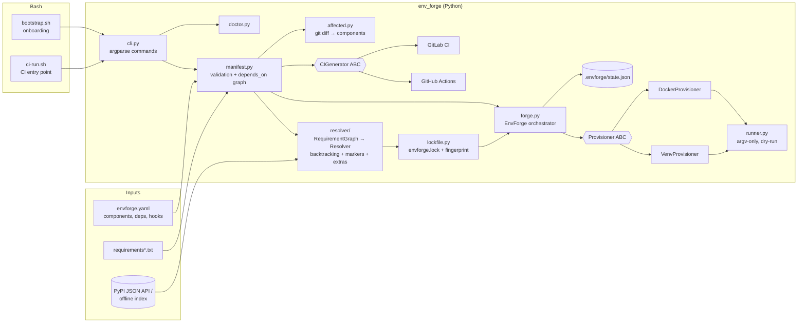

# env_forge

**Developer environment & CI tooling automation for multi-team codebases.**

`envforge` is a Python + Bash CLI that turns one declarative file (`envforge.yaml`) into:

- **Automated dependency resolution** – merges the requirements of every component in a
  monorepo, resolves them with a backtracking resolver (PyPI JSON API or an offline index),
  explains cross-team conflicts by naming who asked for what, and writes a deterministic
  per-component lockfile.
- **Isolated test environments with one command** – `envforge up api` builds a `venv` or
  Docker container with exactly the locked packages, runs setup hooks, injects env vars, and
  reuses the environment until the lock changes.
- **CI/CD integration** – `envforge ci generate` emits GitHub Actions and GitLab CI pipelines
  (lock check + component/Python matrix), `envforge affected` limits CI to components touched
  by a change (including reverse dependencies), and `scripts/ci-run.sh` gives every CI system
  the same entry point.
- **Onboarding** – `scripts/bootstrap.sh` installs the tool, runs `envforge doctor` to check
  prerequisites and provisions everything, so a new engineer goes from clone to green tests
  in one step.

## Architecture



Flow of `envforge test api`:

```
envforge.yaml ──► Manifest ──► (lock fresh?) ──► EnvSpec(api + depends_on paths, pinned reqs)
                                                     │
                     env_id = project-component-sha(python, pins, image)
                                                     │
              state.json has live env_id? ── yes ──► reuse
                                                     │ no
                         Provisioner.up(): preflight → create → check system tools
                                           → pip install --no-deps -r lock → setup hooks
                                                     │
                         run test command ──► .envforge/reports/summary.json
```

### Key design decisions

| Decision | Why |
| --- | --- |
| `Provisioner`, `PackageIndex`, `CIGenerator` are abstract base classes with registries | Teams can add backends (e.g. Kubernetes pods, an internal artifact server, Jenkins) without touching the core. |
| Lockfile stores the full transitive closure; installs use `pip --no-deps` | Environments are byte-for-byte repeatable and pip never re-resolves behind your back. |
| Manifest fingerprint embedded in the lock | `envforge lock --check` in CI catches anyone editing requirements without re-locking. |
| Per-component resolution, plus a drift report | Teams stay isolated (no global lock-step upgrades) but version drift across teams is still visible. |
| Env id = hash of python + pins + image | Unchanged environments are reused instantly; a lock change transparently rebuilds and retires the old env. |
| All subprocesses go through `Runner` (argv lists, no `shell=True`) | One place for `--dry-run`, logging and test doubles. Manifest commands that need shell syntax are explicitly wrapped in `sh -c`. |
| Only two runtime deps (`PyYAML`, `packaging`) | Easy to bootstrap on fresh machines and CI images. |

## Project layout

```
src/env_forge/
  cli.py              # envforge entry point (all subcommands)
  manifest.py         # envforge.yaml model + validation
  resolver/           # requirements, package indexes, resolver, lockfile
  provision/          # Provisioner ABC, venv + docker backends, registry
  forge.py            # EnvForge orchestrator (up/down/run/test)
  state.py            # provisioned environment registry
  ci/                 # GitHub / GitLab generators, affected-component detection
  doctor.py           # prerequisite checks
  runner.py           # subprocess wrapper + RecordingRunner test double
scripts/
  bootstrap.sh        # one-command onboarding
  ci-run.sh           # portable CI entry point
examples/             # sample monorepo manifest + offline index
tests/                # pytest suite
```

## Manifest

```yaml
version: 1
project: acme-platform
python: "3.11"
index: pypi                # "pypi", a PyPI-compatible JSON API URL, or a path to an offline index
defaults:
  provisioner: venv        # venv | docker
  env: {PYTHONDONTWRITEBYTECODE: "1"}
components:
  common:
    path: libs/common
    owner: team-platform
    requirements: ["requests>=2.28,<3"]
  api:
    path: services/api
    owner: team-payments
    depends_on: [common]               # common's requirements are folded in, its path is on PYTHONPATH
    requirements_files: [requirements.txt]   # -r includes are followed
    system: [git]                      # host/container tools that must exist
    env: {APP_ENV: test}
    setup: ["python -m compileall -q ."]
    test: "python -m pytest -q"
  worker:
    path: services/worker
    provisioner: docker
    image: "python:3.11-slim"
    requirements: ["pyyaml>=6"]
ci:
  providers: [github, gitlab]
  python_versions: ["3.11"]
  os: [ubuntu-latest]
  affected_only: false     # true: CI only tests components touched by the change
  install: "pip install env-forge"
```

See [`examples/envforge.yaml`](examples/envforge.yaml) for a complete example.

## How to run

Requirements: Python 3.9+, `git`. Docker is only needed for components with
`provisioner: docker`. The venv provisioner needs a `pythonX.Y` interpreter matching the
manifest's `python` on `PATH` (pyenv, uv, apt, Homebrew all work). No credentials are
needed; network access to PyPI is needed unless the manifest points at an offline index.

```bash
# install the tool
python3 -m venv .venv && . .venv/bin/activate
pip install -e '.[dev]'          # or: make install

# try it on the bundled example (uses the offline index, no network)
cd examples
envforge validate
envforge show
envforge lock                    # writes envforge.lock, prints version drift
envforge doctor                  # checks interpreters, docker, tools, lock, disk
envforge up common api           # provision isolated envs (venv)
envforge run api -- python -c "import requests; print(requests.__version__)"
envforge test --ephemeral        # provision + test every component, then tear down
envforge list
envforge down --all

# CI integration
envforge ci generate             # writes .github/workflows/envforge.yml and .gitlab-ci.yml
envforge ci generate --check     # fail if committed pipelines drifted from the manifest
envforge affected --base origin/main --json
```

In a real repository, onboarding is a single command:

```bash
./scripts/bootstrap.sh           # install envforge, run doctor, re-lock if needed, provision all
```

and CI runs:

```bash
CI_AFFECTED_BASE=origin/main scripts/ci-run.sh
```

Every command accepts `--dry-run` (print commands instead of executing them) and `-v`.

### Configuration via environment

| Variable | Purpose |
| --- | --- |
| `ENVFORGE_HOME` | Cache directory for index metadata (default `~/.cache/envforge`). |
| `ENVFORGE_PYPI_URL` | PyPI-compatible JSON API base URL (e.g. an internal mirror). |
| `ENVFORGE_DOCKER` | Docker-compatible CLI to use (e.g. `podman`). |
| `ENVFORGE_PYTHON_OVERRIDE` | Interpreter version to provision with (used by CI matrices). |
| `ENVFORGE_DEBUG` | Enable debug logging. |

See [`.env.example`](.env.example). Never put credentials in `envforge.yaml`; if a private
mirror needs auth, supply it through the environment.

### Exit codes

`0` ok, `1` test failures / generic error, `2` manifest error, `3` resolution conflict,
`4` lockfile missing or stale, `5` provisioning error, `6` external command failed.

## How to test

```bash
make install     # creates .venv with env-forge[dev]
make test        # pytest suite
make cov         # with coverage report
make lint        # shellcheck the bash scripts (if shellcheck is installed)
```

The test suite needs no network, Docker or extra interpreters: resolution runs against an
in-memory `StaticIndex`, and provisioning is exercised through `RecordingRunner`, which
records every command (`python -m venv`, `pip install --no-deps`, `docker run ...`) for
assertions instead of executing it.
